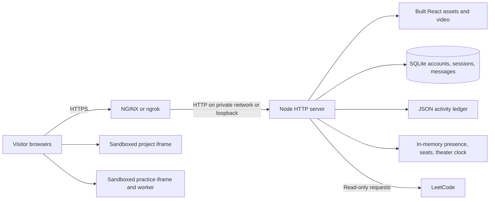

# Technical architecture

Office Hours is a single Node service with a React browser client. NGINX or ngrok provides the public entry point. The server manages identity, presence, desk reservations, messages, activity, and the shared theater clock. Visitors run project code on their own devices.

## Deployment and trust boundaries

Production starts at `server/index.mjs`, which composes the multiplayer, activity, and LeetCode middleware before serving `dist/`. MP4/WebM responses use `server/video.mjs` for byte-range streaming. Development mounts the same middleware inside Vite through `vite.config.js`.

Run one backend process per office. Separate processes have independent presence and theater clocks. Sharing a SQLite file does not synchronize them; the JSON activity ledger also assumes one writer. Horizontal scaling requires shared presence, an event broker, and transactional activity storage.

## Component map

| Component | Responsibility | Main implementation |
| --- | --- | --- |
| App shell | Room navigation, workspace/dialog state, controls | `src/App.jsx` |
| Multiplayer client | Username entry, session recovery, SSE subscription, actions, remote avatars | `src/Multiplayer.jsx` |
| Studio simulation | Local animation loop, movement/pathfinding, chairs, NPC routines | `src/Office.jsx`, `src/world.js`, `src/PlayerSprite.jsx` |
| Character dialogue | NPC replies and private messages to other players | `src/Conversation.jsx`, `src/ChatWindow.jsx` |
| Computer workspace | Multi-file editing and sandbox preview | `src/ProjectWindow.jsx`, `src/projectFiles.js` |
| Algorithm room | Problem selection, local JavaScript practice, profile leaderboard | `src/LeetCodeRoom.jsx`, `src/LeetCodeWorkspace.jsx`, `src/practiceRunner.js` |
| Pair practice | Local NPC goals, suggestions, role swapping, recap | `src/PairLobby.jsx`, `src/PairPanel.jsx`, `src/pairing.js` |
| Theater | Seating animation, wall video, fullscreen player, shared controls | `src/TheaterRoom.jsx`, `src/watchParty.js` |
| Shared playback math | Initial demo state and loop position calculation | `server/theaterPlayback.mjs` |
| Identity and world API | SQLite, sessions, validation, SSE fanout, seat ownership | `server/multiplayer.mjs` |
| Activity tracking | Foreground activity and NPC pairing ledger | `src/activityClient.js`, `server/activity.mjs`, `server/activityModel.mjs` |
| External data adapter | Read-only LeetCode catalog, statements, public profiles | `server/leetcode.mjs`, `src/leetcodeClient.js` |
| Deployment | Production image, persistent volume, event-stream proxy | `Dockerfile`, `compose.yaml`, `deploy/nginx.conf` |
| Temporary sharing | Build, ngrok tunnel, production server lifecycle | `scripts/share.mjs` |

## Identity and sessions

The browser posts a username to `/api/auth/register` or `/api/auth/login`. Both enter an existing normalized username or create an account. This is a username selector, not proof of identity: anyone who knows a username can enter that account and access its messages.

The server creates a random session token, stores its hash in SQLite, and returns an HttpOnly, SameSite=Lax cookie. Sessions expire after seven days. HTTPS deployments use Secure cookies. `/api/auth/me` restores the browser session; logout revokes it and closes its event streams. Display-name edits preserve the account ID.

Write requests validate their Origin against `OFFICE_ORIGIN`. Set that variable to the exact public origin, including scheme and any port. Public deployments need HTTPS. The ngrok launcher sets both the allowed origin and secure-cookie flag automatically. `TRUST_PROXY=1` trusts NGINX's overwritten `X-Real-IP` for authentication throttling; use it only when the backend is reachable through that trusted proxy.

## Multiplayer data flow

1. A signed-in tab connects to `/api/world/events?client=...&room=...` with a unique client ID and session cookie.
2. The server sends current state and streams presence, messages, theater updates, and reactions. The browser reconnects after connection loss.
3. The tab posts actions to `/api/world/action`. The server authenticates the cookie, validates the client and action, applies rate limits, and broadcasts accepted updates.
4. Movement and NPC animation run locally. The server validates position bounds and room membership, but does not simulate authoritative collision physics. NPC routines are independent per browser.
5. Before a visitor sits at a studio or algorithm desk, `claim-seat` atomically reserves it in the single server process. Another client cannot claim the same desk. `release-seat`, leaving the room, logout, or disconnect releases it. Theater sofas currently use local seating.

The server sends heartbeats and removes stale connections. A broken connection can retain presence/reservations for roughly 30–40 seconds. Limits currently cap the service at 200 connections total and five per account; these limits are not a measured capacity guarantee.

Private chat is persisted and delivered only to its sender and recipient. Administrators can read the database; messages are not end-to-end encrypted. NPC dialogue is deterministic local behavior, with no AI provider.

## Browser execution

The studio editor keeps a flat collection of HTML, CSS, and classic JavaScript files. `buildProjectDocument` assembles the selected HTML entry, resolves local script/stylesheet references, and includes unreferenced CSS/JS. The result is loaded into an opaque-origin iframe with `sandbox="allow-scripts"`. The editor has no npm build system, shell, or native-language compiler. This sandbox separates project code from application identity/storage, but ordinary web previews may still make network requests or consume browser resources.

Algorithm practice uses a worker inside a separate opaque-origin iframe. Its Content Security Policy blocks network access and the runner terminates execution after two seconds. Cases are local practice fixtures, not official LeetCode hidden tests. Official submission opens LeetCode separately.

The backend never evaluates submitted project code. Drafts are browser-local and are not synchronized between accounts or devices. Sharing code requires an explicit application feature; there is no collaborative editor or remote shared cursor implementation.

## Theater synchronization

The backend starts with the bundled Adialante demo playing. It stores source, base position, playing state, update timestamp, revision, and author. Each browser derives the playhead from elapsed time; demo positions wrap modulo the duration, so the timeline continues through repeated loops even with no viewers.

The wall video starts muted on entry and has native looping enabled. Sitting opens a fullscreen dialog at the shared position. Play, pause, restart, and seek publish versioned updates; stale revisions are rejected rather than overwriting a newer action. Audio preferences stay local. Leaving the theater does not stop the clock. An explicit shared pause can still pause playback. Restarting the backend resets the theater state.

Video range responses allow seeking without buffering the entire asset into server memory. Only one video element is mounted per theater view, switching between the room wall and fullscreen player.

## Storage and lifecycle

| Data | Location | Lifetime |
| --- | --- | --- |
| Accounts, hashed sessions, messages | SQLite, default `.data/office.sqlite` | Persists across restarts; messages capped at the most recent 10,000 |
| Account activity and pairing time | JSON, default `.data/activity.json` | Persists across restarts; one writer |
| Presence, seat reservations, theater state, rate limits | Node memory | Reset on restart |
| Studio project files | Browser session storage | Per tab/session; not account-synced |
| Algorithm drafts and tracked public profiles | Browser local storage | Per browser; not account-synced |
| Shared-link instance data | `.data/shared-office.sqlite`, `.data/shared-office-activity.json` | Persists separately from development |
| Container data | `office-data` volume mounted at `/app/.data` | Persists until volume deletion |

Back up SQLite with an SQLite-aware backup or stop its writer before copying the database and associated WAL state. Back up the activity JSON as well. Never run `docker compose down -v` if you need the stored data.

## HTTP surface

| Route | Purpose |
| --- | --- |
| `GET /api/auth/me` | Current session/account |
| `POST /api/auth/register`, `POST /api/auth/login` | Username-only entry |
| `POST /api/auth/profile` | Update display name |
| `POST /api/auth/logout` | Revoke session |
| `GET /api/world/events` | Authenticated SSE world stream |
| `POST /api/world/action` | Move, claim/release seat, chat, theater update, reaction |
| `GET /api/activity/board` | Account time leaderboard |
| `POST /api/activity/heartbeat` | Authenticated foreground/pairing activity |
| `GET /api/leetcode/catalog` | Read-only problem catalog |
| `GET /api/leetcode/problems/:slug` | Read-only problem statement |
| `GET /api/leetcode/profiles/:username` | Public profile data |
| `GET/HEAD /media/*.mp4` | Bundled video, including byte-range requests |

## Operations and testing

NGINX must disable buffering/cache for the event stream and keep its read timeout longer than the server heartbeat interval. The supplied config uses a 75-second timeout. It exposes HTTP on host port 8080; a public deployment still needs an HTTPS terminator and certificate. Static hosting alone cannot replace the Node service.

`npm run share` builds once, launches ngrok, and starts a loopback-only production server after learning its public URL. It uses separate storage to avoid concurrent writers with Vite. Ctrl+C terminates its child processes. Changes need a rebuild and restart to reach that shared instance. Ngrok handles external HTTPS; NGINX is not required for this temporary path.

`npm test` combines Node unit/API tests and browser tests using Playwright with installed Chrome. Browser tests start isolated Vite instances and account databases. `npm run build` validates the production bundle. See the README for install commands, deployment settings, and troubleshooting.
